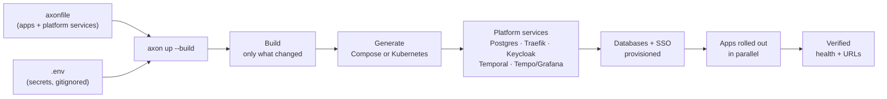

<div align="center">

# axon

**Your whole app stack, running locally or on Kubernetes, from one file and one command.**

[](LICENSE)
[](https://go.dev)
[-lightgrey)](#installation)
[](https://github.com/arshpreetsingh134/axon/actions/workflows/ci.yml)

```bash
axon up --build
```

</div>

axon is a single, dependency-free binary that turns a short TOML descriptor into a
running platform. That platform includes:

- your apps and background workers;
- a Postgres database for each app;
- a single front door, so every app gets its own URL;
- single sign-on;
- workflow orchestration;
- distributed tracing.

axon builds only what changed, starts everything in the right order, wires every service
to the others, keeps secrets out of your files, waits until everything is actually
healthy, and prints the URLs. The same descriptor also generates your GitHub Actions
pipelines: CI on every push, releases pushed to a registry (multi-architecture if you
like) on every tag, and deploys to your Kubernetes clusters with approvals between
environments. You don't write Dockerfiles for the platform pieces, Compose files,
Kubernetes manifests, deploy scripts or CI workflows. It is built for developers who
want production-shaped environments **without becoming DevOps engineers**.

---

## Contents

- [Why axon](#why-axon)
- [How it works](#how-it-works)
- [Installation](#installation)
- [Quick start](#quick-start)
- [Core concepts](#core-concepts)
- [Capabilities](#capabilities)
- [Release and deploy preflight](#release-and-deploy-preflight)
- [The descriptor](#the-descriptor)
- [Command reference](#command-reference)
- [Configuration and environment variables](#configuration-and-environment-variables)
- [Troubleshooting](#troubleshooting)
- [Contributing](#contributing)
- [License](#license)

---

## Why axon

| Without axon | With axon |
|---|---|
| Write and maintain Compose files, Kubernetes YAML, Traefik routes, DB init scripts and Keycloak setup by hand | Describe *what* you want in one `axonfile`; axon generates the rest |
| Rebuild every image on every change | Content-addressed builds: unchanged code is never rebuilt (a no-change redeploy takes seconds) |
| `kubectl rollout restart` after every build, or after every `.env` change | Images are tagged by content and pods carry a config hash, so exactly the changed workloads roll |
| Secrets end up in YAML files and Git history | Secrets live only in a gitignored `.env`; generated files never contain them |
| A deploy "succeeds" but the app is broken | axon waits until every app and module reports healthy and checks every URL |
| Port clashes between projects on one laptop | Free host ports are allocated per project and recorded, so projects never collide |
| A wiki page of manual post-deploy steps | Lifecycle hooks run your scripts at the right moment of every deploy |
| Hand-written CI/CD YAML that drifts from how you deploy locally | `axon ci init` generates CI, release and deploy workflows from the same descriptor; `axon ci check` catches drift |
| Copying API keys into CI settings by hand | `axon ci secrets --set` uploads exactly the secrets the pipelines need, encrypted, never printed |

---

## How it works



Every `axon up` runs the same pipeline:

1. **Lock and hooks.** axon takes a run lock so two deploys never overlap, then runs your
   `pre_generate` and `pre_build` hooks.
2. **Build.** UI bundles (npm/Vite), Go servers (cross-compiled on your machine), app
   images and worker images. Every step is skipped when its inputs haven't changed, and
   images are tagged with a hash of their inputs.
3. **Platform services.** axon generates the platform from your descriptor (Docker Compose
   locally, or Kubernetes manifests) and starts it. On Kubernetes, the API server validates
   every object before anything is applied.
4. **Databases and identity.** axon creates every database, provisions the Keycloak realm
   and client, and runs your `post_fabric` hooks.
5. **Apps.** axon rolls out every app in parallel and waits for each to become healthy.
   Failed Kubernetes rollouts are rolled back automatically.
6. **Verify.** axon seeds identity data, runs your `post_deploy` hooks, probes every front
   door and prints a table of URLs.

Everything axon writes for itself is kept out of version control:
- generated files (Compose, routes, manifests);
- the build cache;
- run state;
- a local log of every deploy.

---

## Installation

### Prerequisites

| Tool | Required? | Why |
|---|---|---|
| **Docker** ([Docker Desktop](https://www.docker.com/products/docker-desktop/), [OrbStack](https://orbstack.dev), or Docker Engine on Linux) | **Yes** | Builds images and runs the local target |
| **kubectl**, plus a local cluster (Docker Desktop Kubernetes, OrbStack, kind, k3d) | Only for the Kubernetes target | Deploys to Kubernetes |
| **Go 1.26+** | If your apps have Go modules, or to build axon from source | Compiles module servers |
| **Node.js 20+ and npm** | If your modules have a UI | Builds UI bundles |
| **git** | Recommended | Release records and source locks |

After installing, run `axon app check` to see which tools axon found on your machine.

### macOS

**Homebrew (recommended):**

```bash
brew install arshpreetsingh134/tap/axon
```

**Prebuilt binary:**

```bash
# Apple Silicon: arm64 · Intel: amd64
ARCH=$(uname -m | sed 's/x86_64/amd64/')
VERSION=0.1.0
curl -fsSL "https://github.com/arshpreetsingh134/axon/releases/download/v${VERSION}/axon_${VERSION}_darwin_${ARCH}.tar.gz" | tar -xz axon
mkdir -p "$HOME/.local/bin" && mv axon "$HOME/.local/bin/"
```

### Linux

**Homebrew on Linux:** `brew install arshpreetsingh134/tap/axon`.

**Prebuilt binary:**

```bash
ARCH=$(uname -m | sed -e 's/x86_64/amd64/' -e 's/aarch64/arm64/')
VERSION=0.1.0
curl -fsSL "https://github.com/arshpreetsingh134/axon/releases/download/v${VERSION}/axon_${VERSION}_linux_${ARCH}.tar.gz" | tar -xz axon
mkdir -p "$HOME/.local/bin" && mv axon "$HOME/.local/bin/"
```

On Linux, add your user to the `docker` group so axon can run Docker without `sudo`:

```bash
sudo usermod -aG docker "$USER"   # then log out and back in
```

### Windows (WSL2)

axon runs on Windows through **WSL2**, which is also the recommended way to run Docker on
Windows. Native Windows support is on the roadmap.

1. In an administrator PowerShell, run `wsl --install`, then reboot. This installs Ubuntu.
2. Install [Docker Desktop](https://www.docker.com/products/docker-desktop/). Under
   **Settings → Resources → WSL integration**, enable your Ubuntu distribution.
3. Open the **Ubuntu** terminal and follow the [Linux](#linux) steps above.
4. Keep your projects inside the Linux filesystem (`~/code/...`), not under `/mnt/c/...`.
   Builds there are many times faster.

### From source

```bash
git clone https://github.com/arshpreetsingh134/axon.git && cd axon
make build                 # → ./bin/axon
make install               # copies it to $(go env GOPATH)/bin
```

### Put axon on your PATH

The binary must be in a directory listed in `PATH`. The steps above use `~/.local/bin`
(Homebrew handles this for you).

| Shell | Add this line | To |
|---|---|---|
| zsh (macOS default) | `export PATH="$HOME/.local/bin:$PATH"` | `~/.zshrc` |
| bash (Linux, WSL) | `export PATH="$HOME/.local/bin:$PATH"` | `~/.bashrc` |
| bash (macOS) | `export PATH="$HOME/.local/bin:$PATH"` | `~/.bash_profile` |
| fish | `fish_add_path $HOME/.local/bin` | run it once |

Open a new terminal, then verify:

```bash
axon version          # axon 0.1.0, then its commit, build date and Go version
axon app check        # toolchain table: go, node, npm, docker, kubectl, git
```

### HOME and the config directory

axon keeps per-user state in **`$XDG_CONFIG_HOME/axon`**, or **`$HOME/.config/axon`** when
`XDG_CONFIG_HOME` is unset. That state is the host-port registry, so projects on one
machine never collide.

- **macOS and Linux:** `HOME` is always set by your login shell; nothing to do.
- **Windows (WSL2):** `HOME` is your Linux home, `/home/<you>`. Don't point it at the
  Windows profile (`/mnt/c/Users/...`).
- **Separate profiles:** set `XDG_CONFIG_HOME` to keep a separate registry, for example on
  CI runners or in sandboxes.

### Shell completion

```bash
# zsh
axon completion zsh > "${fpath[1]}/_axon"
# bash
echo 'source <(axon completion bash)' >> ~/.bashrc
# fish
axon completion fish > ~/.config/fish/completions/axon.fish
```

Homebrew installs completions automatically.

### Uninstall

```bash
brew uninstall axon                 # if installed with Homebrew
rm -f "$HOME/.local/bin/axon"       # if installed manually
rm -rf "$HOME/.config/axon"         # optional: the port registry
```

---

## Quick start

```bash
# 1. Scaffold a project: a controller directory, free host ports, generated secrets
axon cluster new acme --core-image <your app runtime image>
cd acme/acme.axon

# 2. Scaffold an app with one module (a Go server, a Svelte UI and a migration)
axon app new ../acme.web
axon cluster add app --name acme.web --from ../acme.web --host web --db web

# 3. Build and run everything
axon up --build

# 4. Use it
axon env status dev                 # workloads, module health, URLs
axon env logs dev acme.web --follow
axon env test dev                   # health probes and HTTP journeys

# 5. Tear it down (data volumes are kept; add --volumes --yes to delete them)
axon down
```

Your app answers at **http://web.lvh.me:8090**. `lvh.me` and all its subdomains resolve to
`127.0.0.1`, so every app gets its own hostname on your laptop with no `/etc/hosts`
edits.

> **No app runtime image?** Services built from their own Dockerfile, or shipped as a
> prebuilt image, don't need one:
> - **Prebuilt image:** `axon cluster add app --name api --kind project --from-image <image> --port 8080 --external-url http://api.lvh.me:8090`
> - **Your own Dockerfile:** run `axon app new ../api --project`, put your code and
>   Dockerfile in `../api`, then run `axon cluster add app --name api --kind project --from ../api`.

---

## Core concepts

| Concept | What it is |
|---|---|
| **Project (cluster)** | A controller directory, `<name>.axon/`. Its descriptor is `.axon.infra/axonfile`. Each app lives in a sibling directory. |
| **Platform services (fabric)** | Shared infrastructure that axon runs for you: **Postgres** (required), **Traefik** (the front door), **Keycloak** (single sign-on), **Temporal** (workflows), **Tempo + Grafana** (tracing), **ClickHouse** (analytics). Declare only what you need. |
| **App** | A member service with its own descriptor. There are three kinds:<ul><li>`module` (default): a core host that composes modules. Each module is a server, a UI bundle and its own Postgres schema.</li><li>`iam`: the identity app.</li><li>`project`: anything with a Dockerfile, or a prebuilt image, such as workers, APIs or web frontends.</li></ul> |
| **Environment** | `environments/<env>.toml` holds the target (`docker` or `k8s`), namespace, kube context, Postgres mode and release. `dev` works without a file. Per-environment overrides go in `<env>.overrides.toml`. With `[ci] deploy = true` and a `[cloud]` section, CI deploys it (see [Deploys and environment promotion](#deploys-and-environment-promotion)). |
| **Release** | `releases/<version>.toml`: an immutable, digest-sealed record of every image and source commit, deployable as-is with `axon env deploy <env> <version>`. With a registry, images are recorded by registry digest, so a release deploys on any cluster. |
| **Overlay** | `.axon.infra/axon.toml` holds deploy defaults, hooks, image substitutions, things to skip, and the `[ci]` and `[release]` settings. It is kept separate from the descriptor. |

---

## Capabilities

### One-command environments
- `axon up --build` runs the complete pipeline, from an empty machine to verified URLs.
  `axon down` reverses it.
- **Two targets, one descriptor:** Docker Compose for laptops, and Kubernetes (Docker
  Desktop, OrbStack, kind, k3d) when you want production parity.
- **Postgres your way on Kubernetes:** in-cluster (a StatefulSet), a local Docker container
  that axon manages, or an external server.

### Fast, incremental builds
- **Content-addressed:** UI bundles, Go servers and images are rebuilt only when their
  inputs change.
- **Parallel:** builds and rollouts run in parallel (`--jobs`).
- **Scoped:** `--app <name>` builds and rolls out just one app.
- **One module, in seconds:** `axon up --module <token>` (or `<app>/<token>`, or a worker app's name; repeatable)
  rebuilds only that module and rolls only its workload into the running environment. If its UI changed, the
  app's core is reassembled too. Fabric, databases, Keycloak, the IAM seed and the `post_fabric`/`post_deploy`
  hooks are skipped and listed at the end, while `pre_build` hooks still run. Use it for the edit-and-test loop.
  Run a full `axon up --build` after changing the descriptor, secrets, fabric or hooks.
- **Full rebuild:** `--rebuild` ignores every cache.

### Safe, self-healing rollouts
- **Only what changed rolls:** images are tagged by content and pods carry a config hash.
  Changing code, `.env` or config restarts exactly the affected workloads, with no manual
  restarts.
- **Health means healthy:** axon waits for container health and for every module to
  report itself serving.
- **Automatic recovery:** failed Kubernetes rollouts roll back (or stay, with
  `--keep-on-failure`). Workloads left broken by an earlier run are restarted.
- **Readable failures:** a failure shows the failing workload's state and its last log
  lines.
- **Preview first:** `--dry-run` / `axon env plan` show the whole plan. On Kubernetes,
  every object is also validated by the API server without anything being changed.

### Security by default
- **No secrets in files:** they live in a gitignored `.env`. Compose reads them from
  axon's process environment, and Kubernetes Secrets are applied straight from memory.
- **No default passwords:** new projects get random database, SSO-client, Keycloak-admin
  and seed-user passwords.
- **Signing key handled:** the identity signing key (ES256) is generated with mode 0600 and
  kept stable across deploys. `axon env rotate-iam-key` rotates it.
- **Loopback only:** every published port binds to `127.0.0.1`.
- **Audits:** `axon cluster check` and `axon env diagnose` flag secrets that aren't
  gitignored, keys with loose permissions, predictable secrets, literal passwords in the
  descriptor and unpinned images.

### Secrets without `.env` files
Keep API keys out of your repository, out of every file, and out of view of a coding agent that browses your project:

```bash
axon secrets set OPENROUTER_API_KEY        # hidden prompt; or: pbpaste | axon secrets set OPENROUTER_API_KEY
```

```toml
# the app that needs it (axonfile)
[[app]]
name = "acme.ai"
[app.env]
OPENROUTER_API_KEY = "${OPENROUTER_API_KEY}"
```

```go
key := os.Getenv("OPENROUTER_API_KEY")   // injected on every deploy
```

- **Where they're stored:** a Kubernetes Secret per project and environment, in a dedicated `axon-secrets`
  namespace. Tearing down or deleting an app namespace never loses them.
- **Values never leave memory:** axon never accepts a value on the command line, never writes one to a file and
  never prints one. Values reach `kubectl` only on stdin.
- **`axon secrets list`:** names, when each was last changed and which apps use it, plus any reference that has
  no value yet. It never shows values.
- **`axon secrets import --remove`:** moves existing keys out of `.env`.
- **`axon secrets exec -- go run .`:** runs your code locally with the secrets as environment variables.
- **Precedence:** stored secrets win over `.env`. `axon env check` reports any `${NAME}` that is set in neither.

> Requires a Kubernetes context (Docker Desktop or OrbStack Kubernetes is enough), even for the Docker target.
> Anyone with `kubectl` access to that cluster can read the values. To keep an AI coding agent away from them,
> also deny it `kubectl` access to secrets in the agent's own permission settings.

### Batteries-included platform
- **One front door:** routing by host name, with URLs that work identically from your
  browser, from containers and from Kubernetes pods.
- **Single sign-on:** the Keycloak realm, client and seed user are provisioned on every
  deploy, before any app starts.
- **Databases:** one logical database per app, created idempotently.
- **Tracing:** Tempo and Grafana, with OpenTelemetry settings injected into every service.
- **Workflows:** Temporal, with a UI at `temporal.<domain>`.

### A CI pipeline generated from your descriptor
`axon ci init` writes `.github/workflows/axon-ci.yml` for your project. It has two jobs:
- **`check`** (fast, no containers): verifies the pipeline itself is current (`axon ci check`), then runs
  `cluster check`, `env check` and every app's unit tests.
- **`e2e`**: deploys the whole stack on the runner with `axon up --build`, runs `axon env test`, prints diagnostics
  and container logs if anything fails, and always tears down.

More details:
- **Member apps in other repositories:** `ci init` detects them once and records the repositories to check out in
  `axon.toml` under `[ci.checkouts]`. Apps that are symlinks into another checkout (a monorepo subdirectory, say)
  are recorded under `[ci.links]`, and so are modules that link into a sibling repository. The workflow rebuilds the
  same workspace on the runner, using `AXON_REPOS_TOKEN` for private repositories. `ci init --redetect` starts over.
- **Secrets:** every `${VAR}` your apps reference is passed from a same-named GitHub secret, and `ci init` prints
  the list.
- **Drift:** the output is deterministic, so `axon ci check` (locally, or as the pipeline's first step) fails when
  the descriptor has changed and the workflow wasn't regenerated.

```toml
[ci]                                   # in the axonfile or axon.toml; every key is optional
branches     = ["main"]                # push branches that run the pipeline (pull requests always do)
runner       = "ubuntu-latest"
e2e          = true                    # deploy + journeys on the runner
apps         = ["acme.web"]            # deploy only these apps in e2e (default: all)
app_tests    = true
hooks        = true                    # run lifecycle hooks in CI
env          = "ci"                    # created by `ci init` if missing (Docker target)
axon_version = "latest"                # axon release the runner installs

[ci.checkouts]                         # written by `ci init`; workspace path = "owner/repo[@ref]"
"acme.web"              = "acme/web@main"
".axon-ci/acme__mono"   = "acme/mono@main"

[ci.links]                             # app dir = where it points inside a checkout
"acme.api" = ".axon-ci/acme__mono/apps/acme.api"
```

### Releases to a registry
Set a registry, and releases become deployable anywhere:

```toml
[release]
registry = "ghcr.io/your-org"
```

- **`axon release create --build --push`:** builds every app, pushes each image to the registry and records it
  by **digest** (`ghcr.io/your-org/<image>@sha256:…`) in `releases/<version>.toml`.
  `axon env deploy <env> <version>` then deploys exactly those images, pulling them from the registry.
- **`axon ci init`** also writes `.github/workflows/axon-release.yml`. On every `v*` tag it does the same on GitHub's
  runners, then attaches the release record to the GitHub Release. `axon release cut` triggers it.
- **`axon ci secrets`:** lists every secret the pipelines read, whether GitHub already has it, and where its value
  would come from on your machine (axon secrets, then `.env`, then your environment). `--set` uploads the missing
  ones, encrypted with the repository's key and never printed.

**Multi-architecture images:** list more than one platform and every image is built for all of them with
`docker buildx` and pushed as one multi-architecture image. Go module servers are cross-compiled on the host once
per architecture, so only the thin runtime layers run under emulation. Images whose tag (an input hash) is already
in the registry are not rebuilt. The release workflow sets up QEMU and Buildx automatically.

```toml
[release]
registry  = "ghcr.io/your-org"
platforms = ["linux/amd64", "linux/arm64"]   # or: axon release create --build --push --platform linux/arm64
```

Locally, multi-platform builds need a builder that supports them (`docker buildx create --use`, or Docker's
containerd image store).

**Registry credentials:** for GHCR, the workflow's own token can push to your namespace. To also pull private base
images, add an `AXON_GHCR_TOKEN` secret holding a token with `read:packages` (and `write:packages`). Other registries
use `AXON_REGISTRY_USERNAME` / `AXON_REGISTRY_PASSWORD`.

### Deploys and environment promotion
Mark an environment as deployed from CI, and say how to reach its cluster. `axon ci init` then writes
`.github/workflows/axon-deploy.yml`, with one job per environment, each bound to a GitHub Environment of the same
name:

```toml
# environments/staging.toml
name          = "staging"
target        = "k8s"
[cloud]
provider      = "eks"                       # eks | gke | aks | kubeconfig
cluster       = "acme-staging"
region        = "eu-west-1"
role_arn      = "arn:aws:iam::123456789012:role/github-deploy"
[ci]
deploy        = true
auto          = true                        # deploy every successful release

# environments/prod.toml
name          = "prod"
target        = "k8s"
promotes_from = "staging"                   # runs after staging succeeds…
[cloud]
provider      = "kubeconfig"                # a KUBECONFIG secret in the prod GitHub Environment
[ci]
deploy        = true
reviewers     = ["your-login", "acme/ops"]  # …and waits for one of them to approve
wait_minutes  = 10
url           = "https://acme.example"
```

When a release succeeds, each job:
1. checks out the tagged project and its member repositories;
2. signs in to the cloud with OIDC, so no long-lived keys are stored;
3. downloads the release record and pins every app to its released commit;
4. runs `axon env deploy <env> <version>`, pulling the release's images by digest; a pull secret for the registry
   is created in the namespace;
5. runs the journeys, and on failure prints pods and events.

Any environment can also be deployed by hand from the Actions tab (*Run workflow* → environment + version).

Each provider needs these `[cloud]` keys:
- **eks:** `cluster`, `region`, `role_arn`.
- **gke:** `cluster`, `location`, `project`, `workload_identity_provider`, `service_account`.
- **aks:** `cluster`, `resource_group`, `client_id`, `tenant_id`, `subscription_id`.
- **kubeconfig:** nothing; the whole kubeconfig is an Environment secret.

```bash
axon ci environments                  # the GitHub Environments the pipeline uses, and whether they exist
axon ci environments --apply          # create them with reviewers, wait timer and allowed branches
axon ci secrets --kubeconfig ~/.kube/prod.yaml --set   # repository secrets + each Environment's KUBECONFIG
```

### CI and releases from the terminal
These commands work in any GitHub repository, with or without an `axonfile`:

```bash
axon ci status              # every workflow and job for the current commit, with durations and links
axon ci watch               # wait for CI, printing each job as it finishes (exit 1 on failure)
axon ci logs --failed       # only the failing step of each failed job, without runner noise
axon release cut            # next vX.Y.Z tag once CI is green, then follow the release pipeline
axon release cut --bump minor --dry-run
```

`release cut` checks that:
- tracked files have no uncommitted changes;
- every commit is pushed;
- CI is green on `HEAD`; if CI is still running, it waits.

Then it creates an annotated tag, pushes it, and follows the workflow the tag triggers until a GitHub Release
exists.

**Which GitHub account it uses:** `AXON_GITHUB_TOKEN` / `GITHUB_TOKEN` / `GH_TOKEN` if set. Otherwise it asks the
GitHub CLI for the account that owns the repository, so a machine signed in to both a work and a personal account
uses the right one without switching. Only then does it fall back to the CLI's active account.

### Lifecycle hooks
Run your own scripts at `pre_generate`, `pre_build`, `post_build`, `post_fabric`,
`post_deploy`, `pre_down` and `post_down`. Typical uses are linking sources before a build,
seeding data, or running smoke tests after a deploy. Hooks receive `AXON_CLUSTER`,
`AXON_ENV`, `AXON_TARGET`, `AXON_NAMESPACE`, `AXON_KUBE_CONTEXT`, `AXON_DOMAIN` and
`AXON_HTTP_PORT`, and their output is streamed live.

### Testing and diagnosis
- **Journeys:** declarative HTTP tests (`journeys/*.toml`), with JSON subset matching,
  status and header checks, and `${VAR}` expansion.
- **Probe gate:** before the journeys run, `axon env test` checks that every app and module
  reports healthy.
- **`axon env diagnose`:** findings across toolchain, conformance, function, security,
  business and developer experience, with `--json` output for CI.
- **`axon env check`:** catches every `${VAR}` the descriptor uses that is missing from
  `.env`, *before* a deploy starts.

### Releases
- **`axon release create`:** records image IDs, source commits and platform images in a
  record sealed by a SHA-256 digest. With `--push`, images are pushed to a registry and
  recorded by digest (see [Releases to a registry](#releases-to-a-registry)).
- **`axon release cut`:** tags the next version once CI is green and follows the release
  pipeline.
- **`axon release check`:** detects any edit to a record.
- **`axon env deploy <env> <version>`:** deploys exactly what was recorded.
- **`axon release lock` / `axon release checkout`:** pin, and later restore, the source
  commit of every app.

### Scaffolding
- **`axon cluster new`:** a project with free host ports, generated secrets, scripts and
  a runbook.
- **`axon app new` / `axon app add module`:** a Go or Rust server, a Svelte UI, migrations,
  tests and docs.
- **`axon cluster add app | fabric | product`:** each edits the descriptor while keeping
  your comments and ordering.

---

## Release and deploy preflight

Some cluster repositories are released and deployed by a GitHub Actions pipeline that another tool
generates (mycel-gh, in mycel compatibility mode). axon detects them by `github/workflow.toml`. For
those clusters axon doesn't replace the pipeline. It **checks locally, in seconds, what the
pipeline would refuse or change**, so a release or a deploy doesn't fail halfway through, or change
something you didn't expect.

| Check | What it catches | Needs |
|---|---|---|
| `axon release lock --check` | A pinned source commit that is not on its repository's `main`. The release pipeline's gate refuses those. Ancestry is checked with Git on cached mirrors, so large differences can't break it. | Git read access to the source repositories |
| `axon release check --pins` | An image pinned to different digests in different places (member files, Dockerfiles, workflows), an unpinned member image, or a build workflow that builds a different commit than the source lock | Nothing beyond the checkout |
| `axon env check <env>` | A `"${NAME}"` in a descriptor `[app.env]` that the environment's pre-provisioned app env secret doesn't hold. The deploy stops on those. | The key inventory (below) |
| `axon env plan <env> [<release>]` | Every object the deploy would create or change, rendered locally and compared with what the cluster last applied | Read access to the namespace |
| `axon ci deploy <env> <release> --dry-run` | Another deploy run already queued or running, a release record that isn't on `main` yet, or missing secret keys, checked against `origin/main` because that is what the deploy reads | A GitHub token |

### Before you start

- axon 0.6.0 or later (`axon version`).
- A GitHub token for the cluster repository: `gh auth login`, or `GITHUB_TOKEN`.
- For `env plan`: a kube context for the cluster that uses **your own identity**. On AKS:
  `az login`, then `az aks get-credentials ... --context <name> --format exec` and
  `kubelogin convert-kubeconfig -l azurecli --context <name>`. Read access to the namespace is enough.

### The key inventory

`axon env check` compares the keys the descriptor requires with the key **names** the environment's
secret holds. Those names live only in axon's local state, `~/.config/axon/inventory/<cluster>/<env>.keys`,
never in a repository and never with values.

```bash
axon env keys <env>                          # show required keys and what the inventory says the secret holds
axon env keys <env> --live --context <ctx>   # read the names from the cluster (needs `get` on the secret)
axon env keys <env> --add KEY_ONE,KEY_TWO    # or record them by hand
```

### A release, step by step

```bash
axon release lock --check                    # every pinned commit is on main
axon release check --pins                    # every image pin agrees
axon release next                            # the next version, counting records already on main
# ... the pipeline builds the images ...
axon release pin --from-run <run>,<run>      # write the pushed digests into every pin; review with git diff
# ... merge the pins, run the release pipeline ...
axon release record --from-run <run> --select <env>   # add the record and select it for the environment
axon release diff <previous> <new> --markdown          # what changed, traced to commits and pull requests
```

`release pin` and `release record` write ordinary files (member pins and `releases/<version>.toml`)
and commit nothing. Review them and open a pull request as usual.

### A deploy, step by step

```bash
axon env check <env>                                   # required keys are in the secret
axon env plan <env> <release> --context <ctx>          # what the deploy would create or change
axon ci deploy <env> <release> --check                 # the pipeline's own dry run, with the guards
axon ci deploy <env> <release>                         # the real deploy; asks for confirmation
```

`env plan` changes nothing. It renders the deploy's objects from the descriptor, the member files, the
release record, the environment file and the platform outputs, then compares each with the live
object's last-applied configuration:

- `unchanged`: the deploy leaves it alone;
- `~ change`: the deploy will change it, and the differing fields are listed (`--verbose` shows all);
- `+ create`: the deploy will create it.

A plan of the release that is already deployed should show every rendered object unchanged. If it
doesn't, someone deployed something else, or the cluster has drifted; find out before you deploy.

A few values that come from secrets or the identity provider are read from the cluster: the front
door's internal IP, applications' public keys, the platform catalogs' versions, and the first
administrator. Two objects are not rendered: the IAM schema, which ships inside the IAM image, and the
secrets fingerprint, which needs secret values.

### Your own dev environment

On a pipeline-released cluster whose members are image-backed (each member runs a pinned image),
the `dev` environment is deployed the same way, from the same pins, so your namespace runs what the
pipeline would run:

```bash
axon env plan dev                 # what would change (the kube context comes from [deploy].context)
axon up --dry-run                 # the API server checks every object; nothing changes
axon up                           # deploy
```

`axon up` (or `axon env deploy dev`) renders the objects with the dev profile and applies only the
ones the plan creates or changes, keeping each object's last-applied configuration. Before applying,
it pulls any image your local image store lacks, using your own `docker login`, because a dev cluster
has no image pull secret. It then waits for every rolled-out Deployment and runs the cluster's
`post_deploy` hooks.

To run your own code there, without waiting for the pipeline to build and pin it, add
`[[local_build]]` recipes to the cluster's `axon.toml` and pass `--build`. A recipe names the
pipeline's Dockerfile, build context, named contexts and build args for some members, so your image
is built exactly like the pipeline's:

```toml
[[local_build]]
targets    = ["shop.app.cart", "shop.app.orders"]   # [[materialization]] targets of github/workflow.toml
dockerfile = "github/app-build/Dockerfile"           # paths are relative to the cluster directory
context    = "github/app-build"
watch      = ["runtime/shared"]                       # uncommitted changes here also call for a rebuild
[local_build.contexts]
source     = "{checkout}"                             # the member's checkout ([[materialization]] local_checkout_path)
descriptor = "."
[local_build.args]
TOKEN           = "{token}"
SOURCE_REVISION = "{commit}"
[local_build.target_args."shop.app.orders"]           # args for one member win over [local_build.args]
BUILD_LDFLAGS = "-X main.flag=1"
```

```bash
axon up --build --dry-run                   # which members would be built, and why
axon up --build                             # build what changed, deploy it, keep the pins for the rest
axon up --build --app shop.app.cart         # build exactly this member (repeatable)
axon up --build --rebuild                   # every member a recipe covers, without build cache
```

Without `--app`, a member is built when its checkout is ahead of its pin (the source lock's commit
is an ancestor of HEAD) or has uncommitted changes under its source path or a `watch` directory. A
checkout behind or beside its pin keeps the pinned image, so `--build` never deploys older code than
the pipeline's; `--app` builds it anyway. Images are tagged `local/<member>:<12 hex of the image ID>`,
so an unchanged build rolls nothing. `--module` doesn't apply: each member is one image.

The dev profile (SPEC.md Appendix C.11) serves plain HTTP on the front door's port, uses the local
Postgres container, and applies `environments/dev.overrides.toml` last, to workers too. A member that
the reference tool's own deploy must set up first, such as one without a proof-key secret yet, is left
as it is, and the plan says so.

When a newly rendered `<name>-worker` replaces an older `<name>` Deployment that the renderer no longer
renders, both would poll the same task queue. Once the new worker is ready, `axon up` scales the old
one to 0 and keeps its Deployment. `--keep-superseded` leaves it running.

---

## The descriptor

```toml
# acme.axon/.axon.infra/axonfile
build_type = "cluster"
name       = "acme"
domain     = "lvh.me"                 # apps answer at <host>.<domain>
core_image = "<your app runtime image>"

[fabric.postgres]
port = 5545                           # host port (allocated free by `axon cluster new`)

[fabric.traefik]
http = 8090                           # the front door

[fabric.keycloak]                     # optional: single sign-on
realm  = "acme"
client = "acme-iam"
secret = "${OIDC_CLIENT_SECRET}"      # resolved from .axon.infra/.env

[fabric.temporal]                     # optional: workflows
shards = 128
[fabric.tracing]                      # optional: Tempo + Grafana
grafana_port = 3000

[[app]]
name = "acme.web"                     # = the sibling directory ../acme.web
host = "web"                          # → http://web.lvh.me:8090
db   = "web"
[app.env]
STRIPE_KEY = "${STRIPE_KEY}"          # never put secret values here

[[app]]
name  = "acme.worker"
kind  = "project"                     # built from its own Dockerfile
temporal = "temporal:7233"

# axon-only settings (they can also live in .axon.infra/axon.toml)
[deploy]
env    = "dev"
target = "docker"                     # or "k8s"

[hooks]
post_deploy = ["./scripts/seed-demo-data.sh"]
```

Each app directory has its own `axonfile`:
- **App with modules:** `build_type = "app"` and one `[[compose]]` entry per module.
- **Module:** `build_type = "module"` with `[module] token, language`.
- **Worker or service:** `build_type = "project"` with `[project] dockerfile`.

---

## Command reference

Run `axon <verb> --help` for every flag of a verb.

| Area | Commands |
|---|---|
| **Everyday** | `axon up [--build] [--env E] [--dry-run]` · `axon up --module <[app/]token>` · `axon down [--volumes --yes]` |
| **Project** | `cluster new` · `cluster add app\|ext\|fabric\|product` · `cluster remove …` · `cluster set k=v` · `cluster check` · `cluster explain` · `cluster generate [--check\|--diff]` · `cluster build <app>` · `cluster ports` |
| **Apps** | `app new` · `app add module` · `app remove module` · `app set` · `app check [--fix]` · `app build` · `app run` · `app test` |
| **Environments** | `env new` · `env list` · `env show` · `env set` · `env unset` · `env check` · `env plan` · `env deploy` · `env undeploy` · `env status [--json\|--watch]` · `env logs` · `env restart` · `env test` · `env diagnose` · `env iam-keys` · `env rotate-iam-key` |
| **Releases** | `release cut [--bump patch\|minor\|major]` · `release create [--build] [--push] [--registry R] [--platform P,…]` · `release list` · `release show` · `release check` · `release lock` · `release checkout` |
| **Preflight** (pipeline-released clusters) | `release lock --check [--lock-only] [--branch B]` · `release check --pins` · `release next` · `release diff <a> <b> [--markdown]` · `release pin --from-run ID,… [--only T] [--dry-run]` · `release record --from-run ID [--select ENV]` · `env check <env> [--live]` · `env keys <env> [--live\|--add\|--remove]` · `env plan <env> [<release>] [--context C] [--offline] [--out DIR]` · `ci deploy <env> <release> [--check] [--dry-run] [--queue]` |
| **CI/CD** | `ci init [--dry-run] [--redetect]` · `ci check [--diff]` · `ci secrets [--set] [--kubeconfig F]` · `ci environments [--apply]` · `ci status [--json]` · `ci watch` · `ci logs [--failed] [--run ID] [--job NAME]` |
| **Secrets** | `secrets set <NAME>` · `secrets list` · `secrets rm` · `secrets import [--remove]` · `secrets exec -- <cmd>` |
| **Tooling** | `version` · `completion bash\|zsh\|fish` |

**Global flags:**

| Flag | Effect |
|---|---|
| `-y`, `--yes` | Confirm destructive actions. Required when there is no terminal, for example on CI. |
| `-q`, `--quiet` | Print only results and errors. |
| `-v`, `--verbose` | Print every external command axon runs. |
| `--no-color` | Plain output, same as setting `NO_COLOR`. |

**Exit codes:**

| Code | Meaning |
|---|---|
| `0` | Success |
| `1` | Failure, a failing check, or pending changes under `--check` |
| `2` | Usage error |
| `3` | No project or app found in the current directory |

**Output streams:** results go to stdout and progress to stderr. With `--json`, stdout
carries a single JSON document, which makes axon easy to script.

---

## Configuration and environment variables

| Variable | Effect |
|---|---|
| `XDG_CONFIG_HOME` | Where per-user state lives (default `~/.config`) |
| `AXON_GITHUB_TOKEN`, `GITHUB_TOKEN`, `GH_TOKEN` | GitHub token for `ci` and `release cut` (otherwise taken from the GitHub CLI) |
| `AXON_PULL_REGISTRY`, `AXON_PULL_USERNAME`, `AXON_PULL_PASSWORD` | Registry credentials for Kubernetes deploys: axon creates an image pull secret and every workload uses it (the deploy pipeline sets them) |
| `AXON_TARGET` | Default deploy target, `docker` or `k8s` (a flag or the environment file wins over it) |
| `NO_COLOR` / `AXON_NO_COLOR` | Disable colored output |
| `KUBECONFIG` | Passed through to `kubectl` |
| `DOCKER_HOST` | Passed through to `docker` |

**Files in a project:**

| Path | Committed? | Purpose |
|---|---|---|
| `.axon.infra/axonfile` | yes | The descriptor (source of truth) |
| `.axon.infra/axon.toml` | yes | Deploy defaults, hooks, image substitutions, `[ci]` and `[release]` settings |
| `.github/workflows/axon-*.yml` | yes | Generated by `axon ci init` (CI, release, deploy); `axon ci check` reports drift |
| `.axon.infra/.env` | **no** | Secret values (`${VAR}` references). Prefer `axon secrets`, which keeps them in the cluster instead of a file |
| `.axon.infra/secrets/` | **no** | The identity signing key |
| `environments/*.toml` | yes | Environments and their overrides |
| `releases/*.toml` | yes | Immutable release records |
| `.axon.infra/journeys/*.toml` | yes | HTTP journeys |
| `.axon.infra/fabric/`, `.axon.infra/k8s/`, `.axon.infra/.axon/` | **no** | Generated files, the build cache and run state |

---

## Troubleshooting

| Symptom | Fix |
|---|---|
| `axon: command not found` | The install directory isn't on `PATH`. See [Put axon on your PATH](#put-axon-on-your-path). |
| `the docker daemon is not reachable` | Start Docker Desktop or OrbStack. On Linux, run `sudo systemctl start docker`. |
| `host port(s) already in use` | Another program holds the port. Stop it, or change the port in the descriptor. `axon cluster ports` shows which ports are taken. |
| `cannot pull … image(s)` | The image is private. Run `docker login <registry>`, or substitute it under `[images]` in `axon.toml`. |
| `no kube context` / `unreachable` | Turn on Kubernetes in Docker Desktop or OrbStack, or set `context` in `environments/<env>.toml`. |
| `ENV_VALUE_MISSING` | Add the reported key to `.axon.infra/.env`. |
| `*.lvh.me` doesn't resolve while offline | Set `domain = "localhost"`. Browsers resolve `*.localhost` to your machine. |
| A deploy hangs on one app | Run `axon env logs <env> <app> --follow`. With `-v`, axon prints every command it runs. |
| `axon ci check` fails on CI | The descriptor, `axon.toml` or an environment file changed after the workflows were generated. Run `axon ci init` and commit the result. |
| `Multi-platform build is not supported` | Create a builder that supports it: `docker buildx create --use` (CI sets one up automatically). |
| `ci environments --apply` fails on reviewers | GitHub allows required reviewers on private repositories only with a paid plan. Remove `reviewers`, or make the repository public. |
| A CI deploy can't pull images (`ImagePullBackOff`) | For GHCR, give `AXON_GHCR_TOKEN` `read:packages`; for other registries, set `AXON_REGISTRY_USERNAME` / `AXON_REGISTRY_PASSWORD`. |
| `release lock --check`: `not on main` | The pinned commit exists only on another branch. Merge it to `main`, or pin a commit that is on `main`. |
| `env check`: `KEY_NOT_IN_SECRET` | The descriptor now references a key the environment's secret lacks. Have someone with access add it to the secret, then run `axon env keys <env> --live`, or remove the reference. |
| `env check`: `KEY_INVENTORY_MISSING` | Record the secret's key names once: `axon env keys <env> --live --context <ctx>`, or `--add` them. |
| `env keys --live`: `forbidden` | Your role can't read secrets. Ask for `get` on the app env secret, or record the names with `--add`. |
| `env plan` shows many image changes on a release you think is deployed | The environment is on another release. Plan the release in its `environments/<env>.toml`, or check the pipeline's recent deploy runs. |
| `ci deploy`: another run is queued or running | Wait for it. The pipeline can't show whether that run is a dry run or a real deploy, so axon won't queue behind it unless you pass `--queue`. |
| `az` / `kubelogin` token expired | Run `az login` again; kubelogin reuses the Azure CLI's login. |

---

## Contributing

```bash
make dev          # build, and link ~/.local/bin/axon → ./bin/axon (every rebuild is live)
make test-go      # Go unit tests
make test-py      # black-box CLI test suite (pytest, no Docker needed)
make test-e2e     # end-to-end tests that start real containers (needs Docker)
make lint         # go vet + gofmt
```

Issues and pull requests are welcome. Please include a test with every fix, and run
`make lint test` before opening a PR. To publish a release, see
[docs/HOMEBREW.md](docs/HOMEBREW.md).

---

## License

axon is licensed under the [Apache License 2.0](LICENSE). See [NOTICE](NOTICE) for
third-party attributions.

Created by **Arshpreet Singh Bhatia**.
