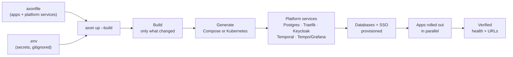

<div align="center">

# axon

**Your whole app stack, running locally or on Kubernetes, from one file and one command.**

[](LICENSE)
[](https://go.dev)
[-lightgrey)](#installation)
[](https://github.com/arshpreetsingh134/axon/actions/workflows/ci.yml)

```bash
axon up --build
```

</div>

axon is a single, dependency-free binary that turns a short TOML descriptor into a
running platform. That platform includes:

- your apps and background workers;
- a Postgres database for each app;
- a single front door, so every app gets its own URL;
- single sign-on;
- workflow orchestration;
- distributed tracing.

axon builds only what changed, starts everything in the right order, wires every service
to the others, keeps secrets out of your files, waits until everything is actually
healthy, and prints the URLs. You don't write Dockerfiles for the platform pieces,
Compose files, Kubernetes manifests or deploy scripts. It is built for developers who
want production-shaped environments **without becoming DevOps engineers**.

---

## Contents

- [Why axon](#why-axon)
- [How it works](#how-it-works)
- [Installation](#installation)
- [Quick start](#quick-start)
- [Core concepts](#core-concepts)
- [Capabilities](#capabilities)
- [The descriptor](#the-descriptor)
- [Command reference](#command-reference)
- [Configuration and environment variables](#configuration-and-environment-variables)
- [Troubleshooting](#troubleshooting)
- [Contributing](#contributing)
- [License](#license)

---

## Why axon

| Without axon | With axon |
|---|---|
| Write and maintain Compose files, Kubernetes YAML, Traefik routes, DB init scripts and Keycloak setup by hand | Describe *what* you want in one `axonfile`; axon generates the rest |
| Rebuild every image on every change | Content-addressed builds: unchanged code is never rebuilt (a no-change redeploy takes seconds) |
| `kubectl rollout restart` after every build, or after every `.env` change | Images are tagged by content and pods carry a config hash, so exactly the changed workloads roll |
| Secrets end up in YAML files and Git history | Secrets live only in a gitignored `.env`; generated files never contain them |
| A deploy "succeeds" but the app is broken | axon waits until every app and module reports healthy and checks every URL |
| Port clashes between projects on one laptop | Free host ports are allocated per project and recorded, so projects never collide |
| A wiki page of manual post-deploy steps | Lifecycle hooks run your scripts at the right moment of every deploy |

---

## How it works



Every `axon up` runs the same pipeline:

1. **Lock and hooks.** axon takes a run lock so two deploys never overlap, then runs your
   `pre_generate` and `pre_build` hooks.
2. **Build.** UI bundles (npm/Vite), Go servers (cross-compiled on your machine), app
   images and worker images. Every step is skipped when its inputs haven't changed, and
   images are tagged with a hash of their inputs.
3. **Platform services.** axon generates the platform from your descriptor (Docker Compose
   locally, or Kubernetes manifests) and starts it. On Kubernetes, the API server validates
   every object before anything is applied.
4. **Databases and identity.** axon creates every database, provisions the Keycloak realm
   and client, and runs your `post_fabric` hooks.
5. **Apps.** axon rolls out every app in parallel and waits for each to become healthy.
   Failed Kubernetes rollouts are rolled back automatically.
6. **Verify.** axon seeds identity data, runs your `post_deploy` hooks, probes every front
   door and prints a table of URLs.

Everything axon writes for itself is kept out of version control:
- generated files (Compose, routes, manifests);
- the build cache;
- run state;
- a local log of every deploy.

---

## Installation

### Prerequisites

| Tool | Required? | Why |
|---|---|---|
| **Docker** ([Docker Desktop](https://www.docker.com/products/docker-desktop/), [OrbStack](https://orbstack.dev), or Docker Engine on Linux) | **Yes** | Builds images and runs the local target |
| **kubectl**, plus a local cluster (Docker Desktop Kubernetes, OrbStack, kind, k3d) | Only for the Kubernetes target | Deploys to Kubernetes |
| **Go 1.26+** | If your apps have Go modules, or to build axon from source | Compiles module servers |
| **Node.js 20+ and npm** | If your modules have a UI | Builds UI bundles |
| **git** | Recommended | Release records and source locks |

After installing, run `axon app check` to see which tools axon found on your machine.

### macOS

**Homebrew (recommended):**

```bash
brew install arshpreetsingh134/tap/axon
```

**Prebuilt binary:**

```bash
# Apple Silicon: arm64 · Intel: amd64
ARCH=$(uname -m | sed 's/x86_64/amd64/')
VERSION=0.1.0
curl -fsSL "https://github.com/arshpreetsingh134/axon/releases/download/v${VERSION}/axon_${VERSION}_darwin_${ARCH}.tar.gz" | tar -xz axon
mkdir -p "$HOME/.local/bin" && mv axon "$HOME/.local/bin/"
```

### Linux

**Homebrew on Linux:** `brew install arshpreetsingh134/tap/axon`.

**Prebuilt binary:**

```bash
ARCH=$(uname -m | sed -e 's/x86_64/amd64/' -e 's/aarch64/arm64/')
VERSION=0.1.0
curl -fsSL "https://github.com/arshpreetsingh134/axon/releases/download/v${VERSION}/axon_${VERSION}_linux_${ARCH}.tar.gz" | tar -xz axon
mkdir -p "$HOME/.local/bin" && mv axon "$HOME/.local/bin/"
```

On Linux, add your user to the `docker` group so axon can run Docker without `sudo`:

```bash
sudo usermod -aG docker "$USER"   # then log out and back in
```

### Windows (WSL2)

axon runs on Windows through **WSL2**, which is also the recommended way to run Docker on
Windows. Native Windows support is on the roadmap.

1. In an administrator PowerShell, run `wsl --install`, then reboot. This installs Ubuntu.
2. Install [Docker Desktop](https://www.docker.com/products/docker-desktop/). Under
   **Settings → Resources → WSL integration**, enable your Ubuntu distribution.
3. Open the **Ubuntu** terminal and follow the [Linux](#linux) steps above.
4. Keep your projects inside the Linux filesystem (`~/code/...`), not under `/mnt/c/...`.
   Builds there are many times faster.

### From source

```bash
git clone https://github.com/arshpreetsingh134/axon.git && cd axon
make build                 # → ./bin/axon
make install               # copies it to $(go env GOPATH)/bin
```

### Put axon on your PATH

The binary must be in a directory listed in `PATH`. The steps above use `~/.local/bin`
(Homebrew handles this for you).

| Shell | Add this line | To |
|---|---|---|
| zsh (macOS default) | `export PATH="$HOME/.local/bin:$PATH"` | `~/.zshrc` |
| bash (Linux, WSL) | `export PATH="$HOME/.local/bin:$PATH"` | `~/.bashrc` |
| bash (macOS) | `export PATH="$HOME/.local/bin:$PATH"` | `~/.bash_profile` |
| fish | `fish_add_path $HOME/.local/bin` | run it once |

Open a new terminal, then verify:

```bash
axon version          # axon 0.1.0 — built from <commit> at <date>
axon app check        # toolchain table: go, node, npm, docker, kubectl, git
```

### HOME and the config directory

axon keeps per-user state in **`$XDG_CONFIG_HOME/axon`**, or **`$HOME/.config/axon`** when
`XDG_CONFIG_HOME` is unset. That state is the host-port registry, so projects on one
machine never collide.

- **macOS and Linux:** `HOME` is always set by your login shell; nothing to do.
- **Windows (WSL2):** `HOME` is your Linux home, `/home/<you>`. Don't point it at the
  Windows profile (`/mnt/c/Users/...`).
- **Separate profiles:** set `XDG_CONFIG_HOME` to keep a separate registry, for example on
  CI runners or in sandboxes.

### Shell completion

```bash
# zsh
axon completion zsh > "${fpath[1]}/_axon"
# bash
echo 'source <(axon completion bash)' >> ~/.bashrc
# fish
axon completion fish > ~/.config/fish/completions/axon.fish
```

Homebrew installs completions automatically.

### Uninstall

```bash
brew uninstall axon                 # if installed with Homebrew
rm -f "$HOME/.local/bin/axon"       # if installed manually
rm -rf "$HOME/.config/axon"         # optional: the port registry
```

---

## Quick start

```bash
# 1. Scaffold a project: a controller directory, free host ports, generated secrets
axon cluster new acme --core-image <your app runtime image>
cd acme/acme.axon

# 2. Scaffold an app with one module (a Go server, a Svelte UI and a migration)
axon app new ../acme.web
axon cluster add app --name acme.web --from ../acme.web --host web --db web

# 3. Build and run everything
axon up --build

# 4. Use it
axon env status dev                 # workloads, module health, URLs
axon env logs dev acme.web --follow
axon env test dev                   # health probes and HTTP journeys

# 5. Tear it down (data volumes are kept; add --volumes --yes to delete them)
axon down
```

Your app answers at **http://web.lvh.me:8090**. `lvh.me` and all its subdomains resolve to
`127.0.0.1`, so every app gets its own hostname on your laptop with no `/etc/hosts`
edits.

> **No app runtime image?** Services built from their own Dockerfile, or shipped as a
> prebuilt image, don't need one:
> - **Prebuilt image:** `axon cluster add app --name api --kind project --from-image <image> --port 8080 --external-url http://api.lvh.me:8090`
> - **Your own Dockerfile:** run `axon app new ../api --project`, put your code and
>   Dockerfile in `../api`, then run `axon cluster add app --name api --kind project --from ../api`.

---

## Core concepts

| Concept | What it is |
|---|---|
| **Project (cluster)** | A controller directory, `<name>.axon/`. Its descriptor is `.axon.infra/axonfile`. Each app lives in a sibling directory. |
| **Platform services (fabric)** | Shared infrastructure that axon runs for you: **Postgres** (required), **Traefik** (the front door), **Keycloak** (single sign-on), **Temporal** (workflows), **Tempo + Grafana** (tracing), **ClickHouse** (analytics). Declare only what you need. |
| **App** | A member service with its own descriptor. There are three kinds:<ul><li>`module` (default): a core host that composes modules. Each module is a server, a UI bundle and its own Postgres schema.</li><li>`iam`: the identity app.</li><li>`project`: anything with a Dockerfile, or a prebuilt image, such as workers, APIs or web frontends.</li></ul> |
| **Environment** | `environments/<env>.toml` holds the target (`docker` or `k8s`), namespace, kube context, Postgres mode and release. `dev` works without a file. Per-environment overrides go in `<env>.overrides.toml`. |
| **Release** | `releases/<version>.toml`: an immutable, digest-sealed record of every image and source commit, deployable as-is with `axon env deploy <env> <version>`. |
| **Overlay** | `.axon.infra/axon.toml` holds deploy defaults, hooks, image substitutions and things to skip. It is kept separate from the descriptor. |

---

## Capabilities

### One-command environments
- `axon up --build` runs the complete pipeline, from an empty machine to verified URLs.
  `axon down` reverses it.
- **Two targets, one descriptor:** Docker Compose for laptops, and Kubernetes (Docker
  Desktop, OrbStack, kind, k3d) when you want production parity.
- **Postgres your way on Kubernetes:** in-cluster (a StatefulSet), a local Docker container
  that axon manages, or an external server.

### Fast, incremental builds
- **Content-addressed:** UI bundles, Go servers and images are rebuilt only when their
  inputs change.
- **Parallel:** builds and rollouts run in parallel (`--jobs`).
- **Scoped:** `--app <name>` builds and rolls out just one app.
- **Full rebuild:** `--rebuild` ignores every cache.

### Safe, self-healing rollouts
- **Only what changed rolls:** images are tagged by content and pods carry a config hash.
  Changing code, `.env` or config restarts exactly the affected workloads, with no manual
  restarts.
- **Health means healthy:** axon waits for container health and for every module to
  report itself serving.
- **Automatic recovery:** failed Kubernetes rollouts roll back (or stay, with
  `--keep-on-failure`). Workloads left broken by an earlier run are restarted.
- **Readable failures:** a failure shows the failing workload's state and its last log
  lines.
- **Preview first:** `--dry-run` / `axon env plan` show the whole plan. On Kubernetes,
  every object is also validated by the API server without anything being changed.

### Security by default
- **No secrets in files:** they live in a gitignored `.env`. Compose reads them from
  axon's process environment, and Kubernetes Secrets are applied straight from memory.
- **No default passwords:** new projects get random database, SSO-client, Keycloak-admin
  and seed-user passwords.
- **Signing key handled:** the identity signing key (ES256) is generated with mode 0600 and
  kept stable across deploys. `axon env rotate-iam-key` rotates it.
- **Loopback only:** every published port binds to `127.0.0.1`.
- **Audits:** `axon cluster check` and `axon env diagnose` flag secrets that aren't
  gitignored, keys with loose permissions, predictable secrets, literal passwords in the
  descriptor and unpinned images.

### Batteries-included platform
- **One front door:** routing by host name, with URLs that work identically from your
  browser, from containers and from Kubernetes pods.
- **Single sign-on:** the Keycloak realm, client and seed user are provisioned on every
  deploy, before any app starts.
- **Databases:** one logical database per app, created idempotently.
- **Tracing:** Tempo and Grafana, with OpenTelemetry settings injected into every service.
- **Workflows:** Temporal, with a UI at `temporal.<domain>`.

### Lifecycle hooks
Run your own scripts at `pre_generate`, `pre_build`, `post_build`, `post_fabric`,
`post_deploy`, `pre_down` and `post_down`. Typical uses are linking sources before a build,
seeding data, or running smoke tests after a deploy. Hooks receive `AXON_CLUSTER`,
`AXON_ENV`, `AXON_TARGET`, `AXON_NAMESPACE`, `AXON_KUBE_CONTEXT`, `AXON_DOMAIN` and
`AXON_HTTP_PORT`, and their output is streamed live.

### Testing and diagnosis
- **Journeys:** declarative HTTP tests (`journeys/*.toml`), with JSON subset matching,
  status and header checks, and `${VAR}` expansion.
- **Probe gate:** before the journeys run, `axon env test` checks that every app and module
  reports healthy.
- **`axon env diagnose`:** findings across toolchain, conformance, function, security,
  business and developer experience, with `--json` output for CI.
- **`axon env check`:** catches every `${VAR}` the descriptor uses that is missing from
  `.env`, *before* a deploy starts.

### Releases
- **`axon release create`:** records image IDs, source commits and platform images in a
  record sealed by a SHA-256 digest.
- **`axon release check`:** detects any edit to a record.
- **`axon env deploy <env> <version>`:** deploys exactly what was recorded.
- **`axon release lock` / `axon release checkout`:** pin, and later restore, the source
  commit of every app.

### Scaffolding
- **`axon cluster new`:** a project with free host ports, generated secrets, scripts and
  a runbook.
- **`axon app new` / `axon app add module`:** a Go or Rust server, a Svelte UI, migrations,
  tests and docs.
- **`axon cluster add app | fabric | product`:** each edits the descriptor while keeping
  your comments and ordering.

---

## The descriptor

```toml
# acme.axon/.axon.infra/axonfile
build_type = "cluster"
name       = "acme"
domain     = "lvh.me"                 # apps answer at <host>.<domain>
core_image = "<your app runtime image>"

[fabric.postgres]
port = 5545                           # host port (allocated free by `axon cluster new`)

[fabric.traefik]
http = 8090                           # the front door

[fabric.keycloak]                     # optional: single sign-on
realm  = "acme"
client = "acme-iam"
secret = "${OIDC_CLIENT_SECRET}"      # resolved from .axon.infra/.env

[fabric.temporal]                     # optional: workflows
shards = 128
[fabric.tracing]                      # optional: Tempo + Grafana
grafana_port = 3000

[[app]]
name = "acme.web"                     # = the sibling directory ../acme.web
host = "web"                          # → http://web.lvh.me:8090
db   = "web"
[app.env]
STRIPE_KEY = "${STRIPE_KEY}"          # never put secret values here

[[app]]
name  = "acme.worker"
kind  = "project"                     # built from its own Dockerfile
temporal = "temporal:7233"

# axon-only settings (they can also live in .axon.infra/axon.toml)
[deploy]
env    = "dev"
target = "docker"                     # or "k8s"

[hooks]
post_deploy = ["./scripts/seed-demo-data.sh"]
```

Each app directory has its own `axonfile`:
- **App with modules:** `build_type = "app"` and one `[[compose]]` entry per module.
- **Module:** `build_type = "module"` with `[module] token, language`.
- **Worker or service:** `build_type = "project"` with `[project] dockerfile`.

---

## Command reference

Run `axon <verb> --help` for every flag of a verb.

| Area | Commands |
|---|---|
| **Everyday** | `axon up [--build] [--env E] [--dry-run]` · `axon down [--volumes --yes]` |
| **Project** | `cluster new` · `cluster add app\|ext\|fabric\|product` · `cluster remove …` · `cluster set k=v` · `cluster check` · `cluster explain` · `cluster generate [--check\|--diff]` · `cluster build <app>` · `cluster ports` |
| **Apps** | `app new` · `app add module` · `app remove module` · `app set` · `app check [--fix]` · `app build` · `app run` · `app test` |
| **Environments** | `env new` · `env list` · `env show` · `env set` · `env unset` · `env check` · `env plan` · `env deploy` · `env undeploy` · `env status [--json\|--watch]` · `env logs` · `env restart` · `env test` · `env diagnose` · `env iam-keys` · `env rotate-iam-key` |
| **Releases** | `release create` · `release list` · `release show` · `release check` · `release lock` · `release checkout` |
| **Tooling** | `version` · `completion bash\|zsh\|fish` |

**Global flags:**

| Flag | Effect |
|---|---|
| `-y`, `--yes` | Confirm destructive actions. Required when there is no terminal, for example on CI. |
| `-q`, `--quiet` | Print only results and errors. |
| `-v`, `--verbose` | Print every external command axon runs. |
| `--no-color` | Plain output, same as setting `NO_COLOR`. |

**Exit codes:**

| Code | Meaning |
|---|---|
| `0` | Success |
| `1` | Failure, a failing check, or pending changes under `--check` |
| `2` | Usage error |
| `3` | No project or app found in the current directory |

**Output streams:** results go to stdout and progress to stderr. With `--json`, stdout
carries a single JSON document, which makes axon easy to script.

---

## Configuration and environment variables

| Variable | Effect |
|---|---|
| `XDG_CONFIG_HOME` | Where per-user state lives (default `~/.config`) |
| `AXON_TARGET` | Default deploy target, `docker` or `k8s` (a flag or the environment file wins over it) |
| `NO_COLOR` / `AXON_NO_COLOR` | Disable colored output |
| `KUBECONFIG` | Passed through to `kubectl` |
| `DOCKER_HOST` | Passed through to `docker` |

**Files in a project:**

| Path | Committed? | Purpose |
|---|---|---|
| `.axon.infra/axonfile` | yes | The descriptor (source of truth) |
| `.axon.infra/axon.toml` | yes | Deploy defaults, hooks, image substitutions |
| `.axon.infra/.env` | **no** | Secret values (`${VAR}` references) |
| `.axon.infra/secrets/` | **no** | The identity signing key |
| `environments/*.toml` | yes | Environments and their overrides |
| `releases/*.toml` | yes | Immutable release records |
| `.axon.infra/journeys/*.toml` | yes | HTTP journeys |
| `.axon.infra/fabric/`, `.axon.infra/k8s/`, `.axon.infra/.axon/` | **no** | Generated files, the build cache and run state |

---

## Troubleshooting

| Symptom | Fix |
|---|---|
| `axon: command not found` | The install directory isn't on `PATH`. See [Put axon on your PATH](#put-axon-on-your-path). |
| `the docker daemon is not reachable` | Start Docker Desktop or OrbStack. On Linux, run `sudo systemctl start docker`. |
| `host port(s) already in use` | Another program holds the port. Stop it, or change the port in the descriptor. `axon cluster ports` shows which ports are taken. |
| `cannot pull … image(s)` | The image is private. Run `docker login <registry>`, or substitute it under `[images]` in `axon.toml`. |
| `no kube context` / `unreachable` | Turn on Kubernetes in Docker Desktop or OrbStack, or set `context` in `environments/<env>.toml`. |
| `ENV_VALUE_MISSING` | Add the reported key to `.axon.infra/.env`. |
| `*.lvh.me` doesn't resolve while offline | Set `domain = "localhost"`. Browsers resolve `*.localhost` to your machine. |
| A deploy hangs on one app | Run `axon env logs <env> <app> --follow`. With `-v`, axon prints every command it runs. |

---

## Contributing

```bash
make dev          # build, and link ~/.local/bin/axon → ./bin/axon (every rebuild is live)
make test-go      # Go unit tests
make test-py      # black-box CLI test suite (pytest, no Docker needed)
make test-e2e     # end-to-end tests that start real containers (needs Docker)
make lint         # go vet + gofmt
```

Issues and pull requests are welcome. Please include a test with every fix, and run
`make lint test` before opening a PR. To publish a release, see
[docs/HOMEBREW.md](docs/HOMEBREW.md).

---

## License

axon is licensed under the [Apache License 2.0](LICENSE). See [NOTICE](NOTICE) for
third-party attributions.

Created by **Arshpreet Singh Bhatia**.
